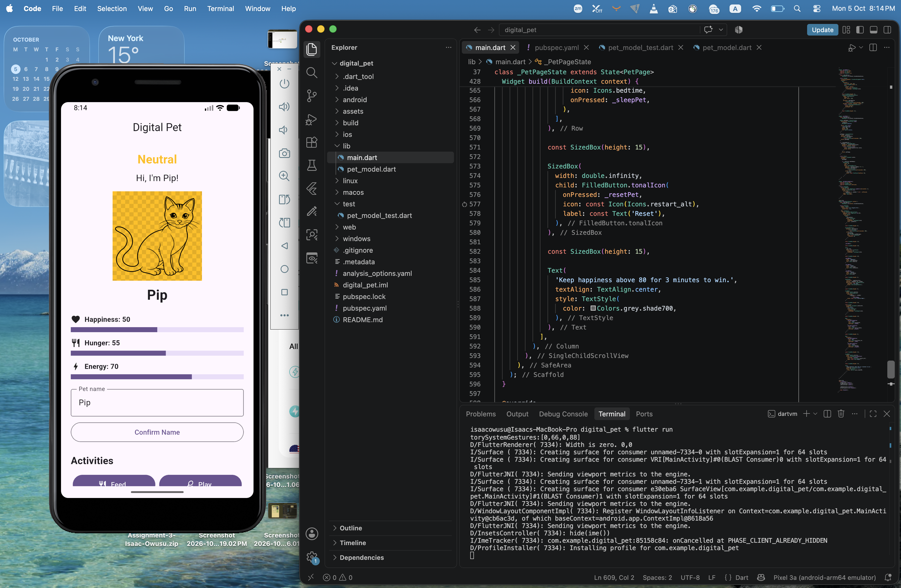
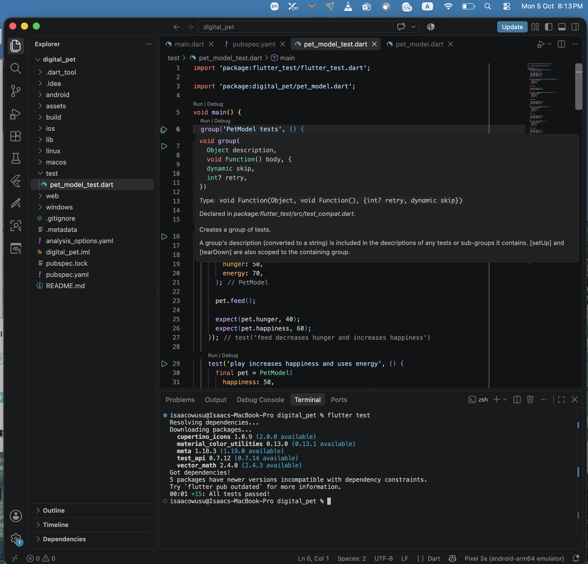

# Digital Pet

A Flutter digital pet application where the user can take care of a pet by feeding, playing with, and managing its energy. The pet's happiness and hunger change based on user actions and timed events.

## Screenshots

### App Working

This screenshot shows the Digital Pet app running with the pet, mood, meters, and available activities.



### Tests Passed

This screenshot shows the automated tests passing successfully.



## Features

- Editable pet name
- Happiness meter from 0–100
- Hunger meter from 0–100
- Energy system from 0–100
- Mood labels:
  - Happy
  - Neutral
  - Unhappy
- Mood-based pet tint using `ColorFiltered`
- Feed, Play, Run, and Sleep actions
- Hunger increases every 30 seconds
- Win condition when happiness stays above 80 for 3 continuous minutes
- Loss condition when hunger reaches 100 and happiness is 10 or lower
- Reset button to restart the pet
- Care actions are disabled after winning or losing
- Animated pet reactions and meter changes
- Reduced-motion support

## Graduate Features

### Energy System

The pet has an energy meter that affects activities such as playing and running. Activities use different amounts of energy, while sleeping restores energy.

### Activity Selection

The user can choose different activities that affect the pet in different ways. For example, playing increases happiness and hunger slightly, while sleeping restores energy.

### Visual Polish and Accessible Motion

The pet uses mood-based tinting, animations, reaction messages, and scaling effects to make the application more interactive. Reduced-motion settings are also respected so that nonessential animations can be disabled.

## Pet Rules

The pet's rules are separated from the Flutter widget tree using a `PetModel` class. The model handles values and game rules such as feeding, playing, sleeping, energy limits, hunger changes, mood, and loss conditions.

The widget tree is responsible for displaying the pet and responding to user interaction. This separation makes the rules easier to test and modify without changing the UI.

## Mood System

The pet's happiness determines its mood:

| Happiness | Mood | Tint |
|---|---|---|
| 71–100 | Happy | Green |
| 30–70 | Neutral | Yellow |
| 0–29 | Unhappy | Red |

The pet uses a grayscale/neutral PNG asset with `ColorFiltered` and `BlendMode.modulate` to apply the mood tint.

## Timer Behavior

Two main timed behaviors are used:

- Hunger increases by 5 every 30 seconds.
- A win timer starts when happiness becomes greater than 80 and must remain above 80 for 3 continuous minutes.

If happiness drops to 80 or below, the pending win timer is canceled.

All timers are canceled when the widget is disposed so they do not continue running after the screen is removed.

## Win and Loss Conditions

### Win

The player wins when the pet's happiness remains strictly above 80 for 3 continuous minutes.

### Loss

The player loses when:

- Hunger reaches 100, and
- Happiness is 10 or lower.

After either outcome, the care actions are disabled until the user presses Reset.

## Testing

Automated tests were added for the pet model to verify:

- Initial pet values
- Feeding behavior
- Playing behavior
- Running behavior
- Sleeping behavior
- Energy limits
- Happiness and hunger clamping
- Mood boundaries
- Hunger timer behavior
- Loss condition
- Reset behavior
- Hunger overflow penalty

The main boundary cases tested include happiness values of 29, 30, 70, and 71, as well as hunger values near 100.

Run the tests with:

```bash
flutter test